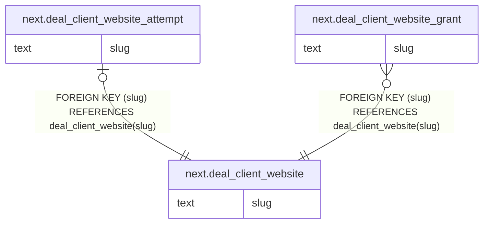

# Client websites

## Description

Tables in this area and the foreign keys between them.

## Tables

| Name                                                                    | Columns | Comment | Type       |
| ----------------------------------------------------------------------- | ------- | ------- | ---------- |
| [next.deal_client_website](next.deal_client_website.md)                 | 10      |         | BASE TABLE |
| [next.deal_client_website_attempt](next.deal_client_website_attempt.md) | 3       |         | BASE TABLE |
| [next.deal_client_website_grant](next.deal_client_website_grant.md)     | 4       |         | BASE TABLE |

## Relations

---

> Generated by [tbls](https://github.com/k1LoW/tbls)
