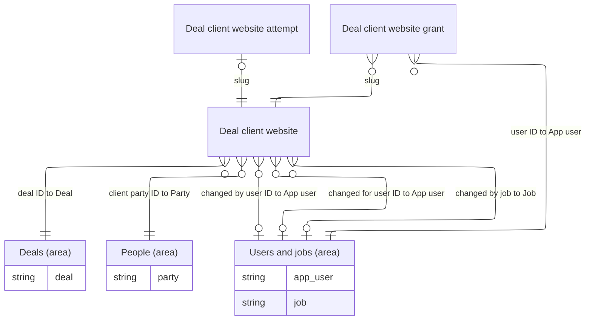

# Client websites

## Connects to

Numbers count foreign keys between the two areas.

[Deals](viewpoint-deals.md) (1) · [People](viewpoint-people.md) (1) · [Users and jobs](viewpoint-users-jobs.md) (4)

## Tables

- [Deal client website](next.deal_client_website.md)
- [Deal client website attempt](next.deal_client_website_attempt.md)
- [Deal client website grant](next.deal_client_website_grant.md)

See each table for its columns and links to other areas.
