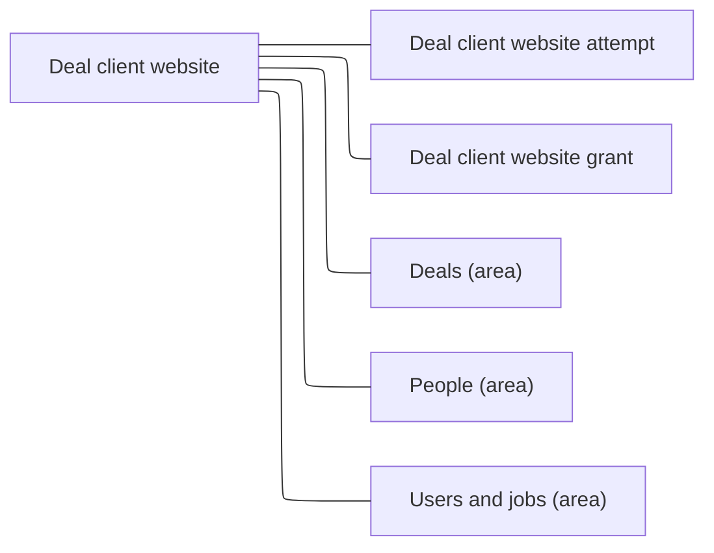
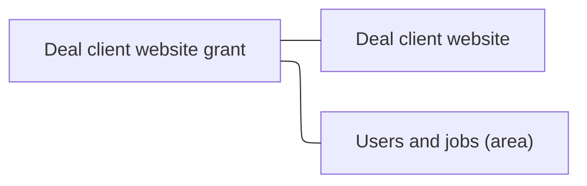

# Client websites

Each line shows a connection. The foreign keys below name the exact columns.

### Deal client website

### Deal client website attempt

### Deal client website grant

## Foreign keys

| From table and columns                                                      | To table and columns                                        |
| --------------------------------------------------------------------------- | ----------------------------------------------------------- |
| [deal_client_website](next.deal_client_website.md) (`changed_by_user_id`)   | [app_user](next.app_user.md) (`id`)                         |
| [deal_client_website](next.deal_client_website.md) (`changed_for_user_id`)  | [app_user](next.app_user.md) (`id`)                         |
| [deal_client_website](next.deal_client_website.md) (`deal_id`)              | [deal](next.deal.md) (`id`)                                 |
| [deal_client_website](next.deal_client_website.md) (`changed_by_job`)       | [job](next.job.md) (`slug`)                                 |
| [deal_client_website](next.deal_client_website.md) (`client_party_id`)      | [party](next.party.md) (`id`)                               |
| [deal_client_website_attempt](next.deal_client_website_attempt.md) (`slug`) | [deal_client_website](next.deal_client_website.md) (`slug`) |
| [deal_client_website_grant](next.deal_client_website_grant.md) (`user_id`)  | [app_user](next.app_user.md) (`id`)                         |
| [deal_client_website_grant](next.deal_client_website_grant.md) (`slug`)     | [deal_client_website](next.deal_client_website.md) (`slug`) |

## Connects to

Numbers count foreign keys between the two areas.

[Deals](viewpoint-deals.md) (1) · [People](viewpoint-people.md) (1) · [Users and jobs](viewpoint-users-jobs.md) (4)

## Tables

- [Deal client website](next.deal_client_website.md)
- [Deal client website attempt](next.deal_client_website_attempt.md)
- [Deal client website grant](next.deal_client_website_grant.md)
