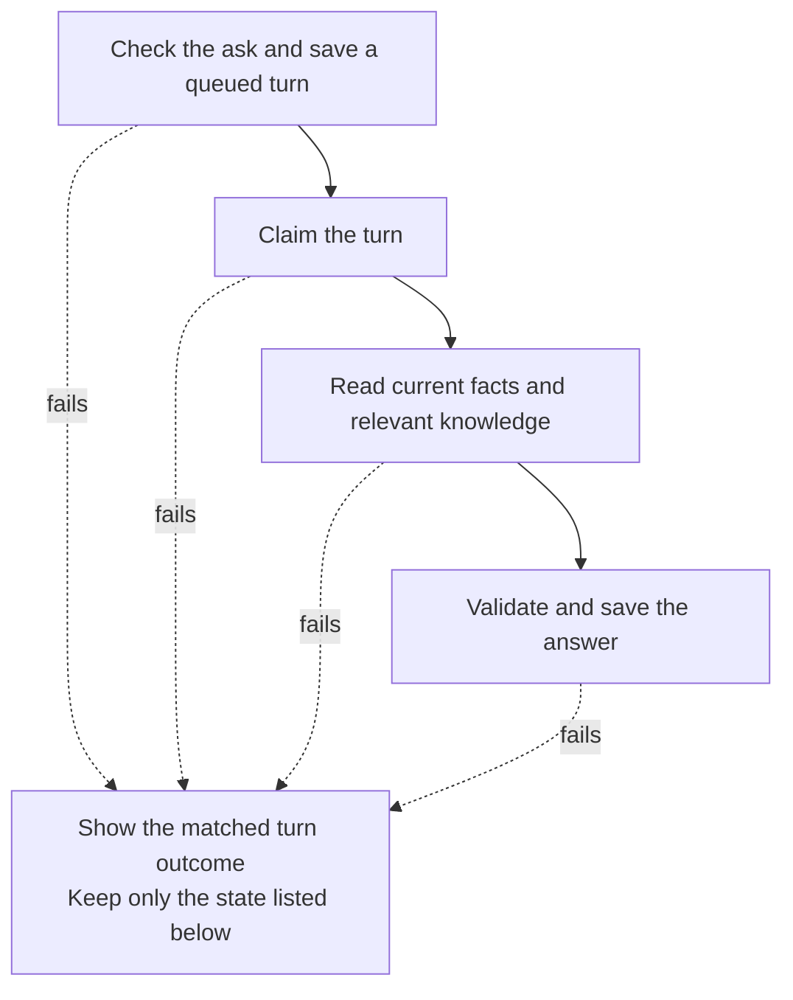
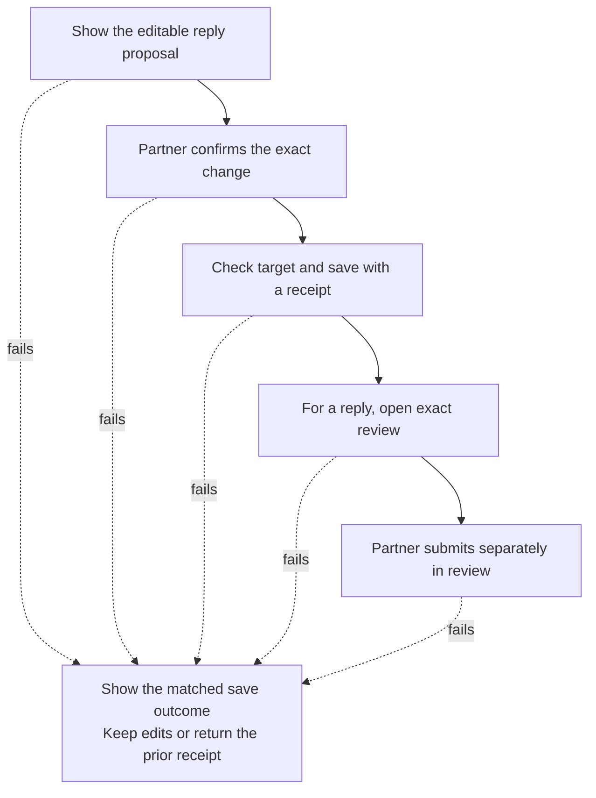
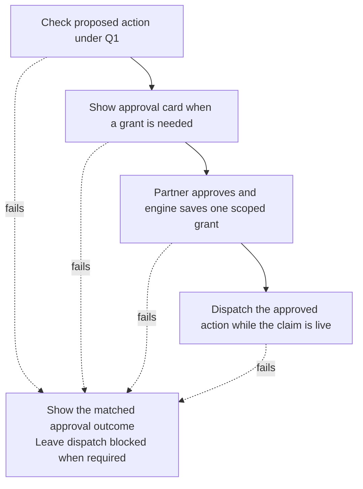
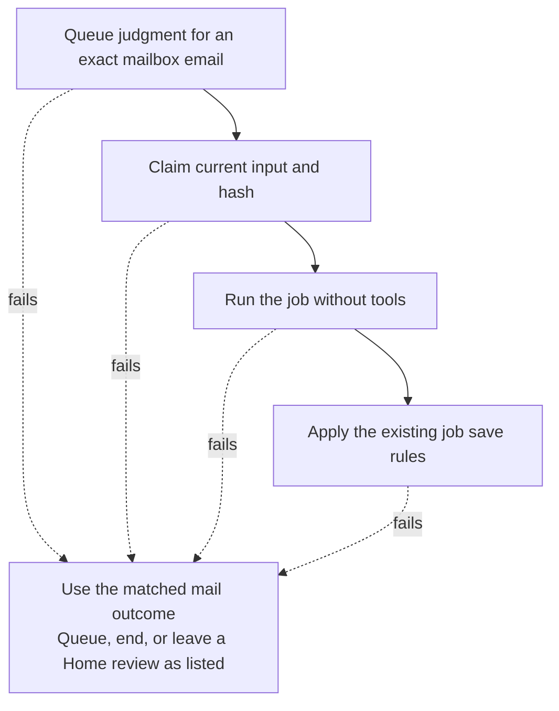

# Doc flows

The diagrams show the main path. Each failure goes to one exit box. Use the [outcome table](#outcomes-to-check) for the exact screen and stored result.

## F1 Ask

Accept a signed-in question up to 4,000 characters with its request key and optional exact context. The first ask creates the chat and turn together. A draft review binds the exact pending draft, version, and mailbox email. Claim the oldest available turn before mail with one slot per partner. A fresh claim has its own lease and evidence. The runner has up to 45 seconds in a 60-second lease and gets up to 12 prior answered turns. All reads share four slots. The app reloads the saved state for the current partner.

## F2 Clarify

Resolve exact record IDs before using facts. For several accessible matches, save a clarification and show the exact links. Same-name deal chips show recorded phase and owner when available. Number indistinguishable matches and ask the partner to open the linked records before choosing. For missing records, ask for an accessible one. Mail needs an exact activity ID from the partner's mailbox. A clarification has no save card. A reply to it starts a new turn.

## F3 Answer or fail

Read current facts and query the approved notes and data through `read_playbook` and `read_guidance` when relevant. Use the [playbook read contract](playbooks.md#read-approved-playbooks-and-guidance) for ties and paging. Answer from the evidence available and say when knowledge is unavailable. A failed required record read fails the turn. A general or local answer can omit Doc sources when the claim returned no Doc records and there is no proposal.

Validate current-claim sources and proposal targets before saving the answer, provider and any proposal. Pin knowledge supplied as evidence in `doc_knowledge_revision`. Show exact sources and provider attribution. Label computed plan dates as expected. Compare facts in prose to the returned evidence in staging.

## F4 Propose and confirm

An answered turn can hold a proposal without a business save. The app sends the turn ID, a separate save key and any edits. The engine rechecks access and version, then commits the result, receipt and confirmation together. A note goes to Activity and the confirming partner owns a new step. A new reply starts at version 1. A revision changes only the subject or body. In reply review the partner checks recipients and uses **Send reply**. Submission freezes the approved values for delivery under [door 22](../new-database.md#22-reply-drafts-and-their-delivery).

## F5 Mac waiting and provider fallback

Chat and mail each have a real CLI readiness probe with a plain reason when unavailable. Ask Doc uses the chat result. A sign-out or plan limit requeues the turn and lets the ready second choice claim it. Show the provider and reset time when known. Existing drivers recheck sign-in after 30 seconds and a plan limit without a reset after five minutes. [Picker](setup.md#ask-doc-picker)

## F6 Approve an action

Check every covered action before dispatch. A matching active grant allows the action without another prompt. Bind a new approval request to the partner, turn, claim and exact action. Show the scope in Ask Doc and let the grant owner revoke it in Settings. An approval writes a grant, and F4 still controls business saves and reply submission. Only the originating Mac can dispatch the pending action within its live claim and model window. [Starting policy and late approval](questions.md#q1-standing-grant-scope)

## F7 Unattended mail

Queue summary, filing, split and introduction jobs under the existing intake rules. A mail-ready Mac uses its configured mail backend after waiting chats. Give it the job instructions and the claimed email as evidence. Mail gets no tools or Doc credential under [Q2](questions.md#q2-unattended-mail). Keep existing summary limits and filing, split and introduction rules. [Mail judgment](../new-database.md#mail-judgment-jobs)

## F8 Prepaid backup

When enabled, backup uses the same lease and result checks for eligible chat, summary or filing. It considers the readiness of that kind or the two-minute wait. A requeued chat starts a fresh wait. Mail uses creation time. Split and introduction stay on the Mac. Backup checks chat first, runs at most one item per partner per tick, and labels chat answers **Answered by backup**. [Doc backup](../new-database.md#doc-backup)

## F10 File or dismiss an exact email

Bind an authorized mailbox activity to the exact pending `proposal_id` from Home. If the partner gives only an email, find its visible pending filing cards and ask when several fit. Preview the selected open deal and any reason requirement. Link to that exact Home review. Only the signed-in partner's accept or dismiss action calls the decision door with its save key and required reason. [Door 21](../new-database.md#21-suggestions-stored-and-decided)

## Outcomes to check

| Step and outcome                                                                         | What the partner sees                                                                                                                           | What is saved                                                                                                                                                                                                      |
| ---------------------------------------------------------------------------------------- | ----------------------------------------------------------------------------------------------------------------------------------------------- | ------------------------------------------------------------------------------------------------------------------------------------------------------------------------------------------------------------------ |
| F1 Signed out, missing write proofs or invalid input                                     | Sign in when expired. Otherwise show the refusal.                                                                                               | No new turn.                                                                                                                                                                                                       |
| F1 Unknown or foreign draft, or stale draft context                                      | Unavailable for unknown or foreign. Fresh review for a changed or finished draft.                                                               | No new turn or retry.                                                                                                                                                                                              |
| F1 Same key and request                                                                  | Show the saved turn if it is queued, working or answered. Use the F3 retry outcome if it failed.                                                | Replay creates no turn.                                                                                                                                                                                            |
| F1 Changed request under the same key or new key in a busy chat                          | Show `key_reuse` or `turn_in_progress`, respectively.                                                                                           | Keep the original turn.                                                                                                                                                                                            |
| F1 Chat reload fails or chat is missing                                                  | Offer read retry on failure, **New chat** for discarded old history, or **Conversation unavailable** for an unknown chat.                       | Keep chat state.                                                                                                                                                                                                   |
| F2 Ambiguous or unavailable subject                                                      | Ask for the exact accessible record or mail review.                                                                                             | Clarification and authorized choices when available.                                                                                                                                                               |
| F3 Knowledge unavailable or empty                                                        | Answer from verified evidence and name the missing knowledge.                                                                                   | Save the answer and its authorized evidence.                                                                                                                                                                       |
| F3 Playbook query matches more than ten topics                                           | Ask the partner to narrow the topic or filters before choosing a playbook.                                                                      | Save a clarification.                                                                                                                                                                                              |
| F3 Another guidance page remains when the read budget is spent                           | Show the verified partial answer and offer a narrower follow-up. Start the next claim with fresh filters.                                       | Save the answer with the authorized guidance already read.                                                                                                                                                         |
| F3 Guidance cursor requires a restart at the read limit                                  | Say the guidance changed. Answer from other verified evidence and offer a narrower follow-up. Start with a fresh query on the next claim.       | Save the answer with the other authorized evidence.                                                                                                                                                                |
| F3 Top playbooks tie                                                                     | Ask the partner to choose an accessible title. Recheck the chosen ID with the same filters on the next turn.                                    | Save a clarification.                                                                                                                                                                                              |
| F3 Required record read or runner fails                                                  | Show the failed turn.                                                                                                                           | Save failed state.                                                                                                                                                                                                 |
| F3 Completion returns 422                                                                | A corrected result may still be accepted within the lease. The current Mac posts `failed` on its next attempt.                                  | Leave claim open on 422. Save failed state if the Mac's failed completion succeeds.                                                                                                                                |
| F3 Lost completion response or temporary failure                                         | Retry completion with the same claim within its lease. The app shows the saved state.                                                           | A committed result stays saved. A missing, foreign, expired or completed claim returns 404.                                                                                                                        |
| F3 Latest eligible failed turn retried with its original key and request                 | Show the same question back in the queue.                                                                                                       | Requeue that turn without creating a new one.                                                                                                                                                                      |
| F3 Failed retry superseded or bound draft changed or gone                                | Keep the superseded question in history or offer fresh draft review.                                                                            | Keep the failed turn without requeueing it.                                                                                                                                                                        |
| F4 Save response lost or same key and edits replayed                                     | Retry the same request and show the original receipt when available.                                                                            | At most one confirmation and business change.                                                                                                                                                                      |
| F4 Invalid edit, missing write proof, changed key use, already confirmed, or no proposal | Show the refusal and keep edits. An expired session returns to sign-in.                                                                         | No new change.                                                                                                                                                                                                     |
| F4 Target stale, open step exists, or draft changed or finished                          | Keep edits. Link to the record for target or step conflicts. Open fresh review for a draft conflict.                                            | No change.                                                                                                                                                                                                         |
| F4 Existing draft for the same email or pending mailbox conversation                     | Link to the exact existing draft and say the new text was unused.                                                                               | Save confirmation and receipt. Preserve draft text.                                                                                                                                                                |
| F4 Draft save succeeds and review fails to open                                          | Show that the draft was saved. Offer to reopen the exact review using the receipt's `href`.                                                     | Keep the draft and confirmation receipt. Reopening makes no second save or submission.                                                                                                                             |
| F4 Separate reply submission refused or delivery fails                                   | Show the review refusal. Retry only a failure before dispatch. Check delivery when a prior attempt is unconfirmed.                              | Keep the draft or the recorded delivery state under door 22.                                                                                                                                                       |
| F5 No link, unavailable Mac, busy slot, sign-out or plan limit                           | Show setup, the readiness reason, or free-slot wait. Show ready fallback when it takes the claim.                                               | Keep the queued turn. A blocker records chat readiness.                                                                                                                                                            |
| F5 Link revoked or lease expires without completion                                      | Revoked link stops polling. A queued turn can be claimed again.                                                                                 | Keep the turn and use a fresh claim on reclaim.                                                                                                                                                                    |
| F6 Denied, unauthorized, conflicting or superseded decision                              | Close on denial. Show refusal for the other cases.                                                                                              | No grant or dispatch.                                                                                                                                                                                              |
| F6 Decision response lost or replayed after reclaim                                      | Return the saved receipt for the same request and decision key.                                                                                 | No second grant or dispatch.                                                                                                                                                                                       |
| F6 Model times out before lease expiry with approval pending                             | Close the pending card and show the failed turn once the Mac reports failure. A first decision after the model window closes is refused.        | No new grant or dispatch from that card. A committed failure releases the lease and leaves the turn eligible for F3 retry. If the failure is not recorded before lease expiry, a fresh claim can reclaim the turn. |
| F6 First approval reaches the engine after lease expiry                                  | Refuse the first approval. The card says "Doc lost this turn; ask again". Replaying a committed decision returns the original decision receipt. | The expired lease means the turn is lost. Save no grant. Keep dispatch blocked until reclaim. This ruling supersedes [Q1's late-grant option](questions.md#q1-standing-grant-scope).                               |
| F6 Grant revoked                                                                         | Settings shows the revoked grant is unavailable for later actions.                                                                              | Record revocation. No later dispatch under that grant.                                                                                                                                                             |
| F7 Mail unready, plan blocked or failed                                                  | No chat turn. Eligible work waits or goes to backup. A failed filing can appear in Home if it has a destination.                                | Requeue on sign-out or limit and update mail readiness. A live failed completion ends the job even if the source changed.                                                                                          |
| F7 Invalid result                                                                        | A filing review can appear in the same attempt when a destination exists.                                                                       | Return 422 with the claim open. Accept correction within the lease. The current Mac next attempts to post failed.                                                                                                  |
| F7 Lease expires before completion                                                       | The email can wait for another eligible runner.                                                                                                 | Reclaim under a fresh lease and input hash.                                                                                                                                                                        |
| F7 Changed input, stale claim or completed replay                                        | No extra chat or review.                                                                                                                        | Reject an answered result against changed input. Return 404 for missing, foreign, expired or completed claims.                                                                                                     |
| F7 Valid result, existing record wins                                                    | Existing record stays visible. Empty or newly unverified filing can leave a Home review when a destination exists.                              | Keep the first summary, completed split, prior filing decision or matching introduction. Record the job result under existing rules.                                                                               |
| F8 Backup credits exhausted                                                              | Work continues waiting for an eligible runner.                                                                                                  | Requeue, stop sends for the tick and preserve Mac readiness. Later ticks try at most one request while credits stay exhausted.                                                                                     |
| F9 Preference missing, invalid or unauthorized                                           | Show the refusal for an invalid or unauthorized action. Use the key default when no row exists.                                                 | No preference change. A valid delete removes the row.                                                                                                                                                              |
| F10 No eligible filing review, receipt replay or already decided                         | Follow Q5 for missing review. Show the original receipt on replay or the settled state on `already_decided`.                                    | No new decision on these exits.                                                                                                                                                                                    |

## Not drawn yet

- [Live answer and Stop](../new-database.md#live-answer-and-stop) and the waiting question.
- [Visual answers](../new-database.md#visual-answers), suggestions and chat attachments.
- [Record-button sessions](../new-database.md#doc-skill-sessions), new outgoing mail and later provider drivers.
- [Additional business tools](tools.md#not-drawn-yet) beyond the first workflows.
