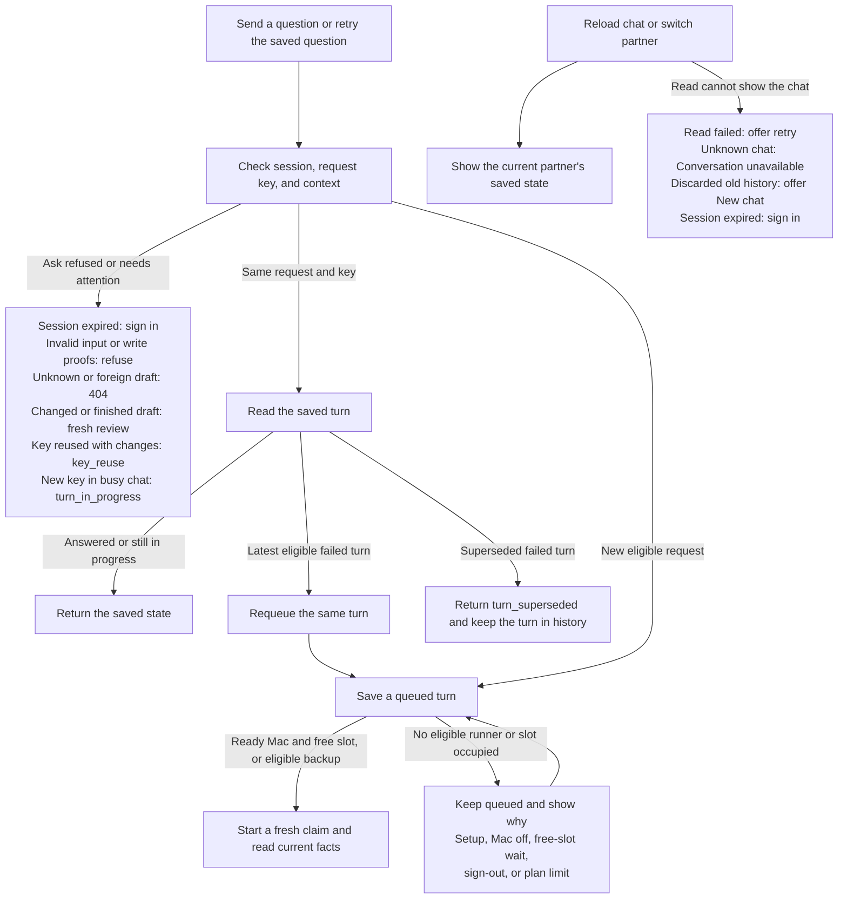
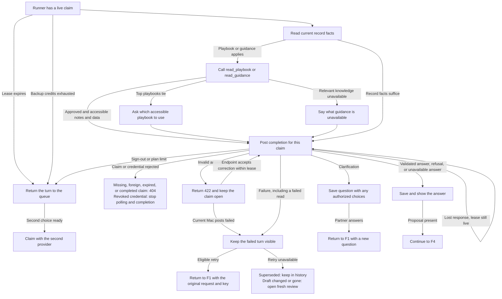
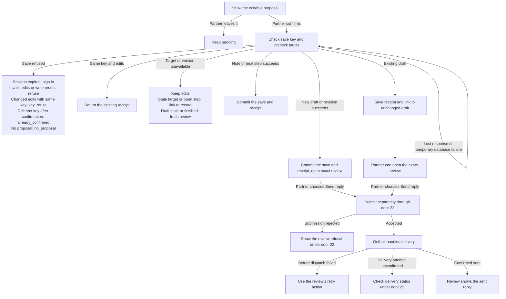
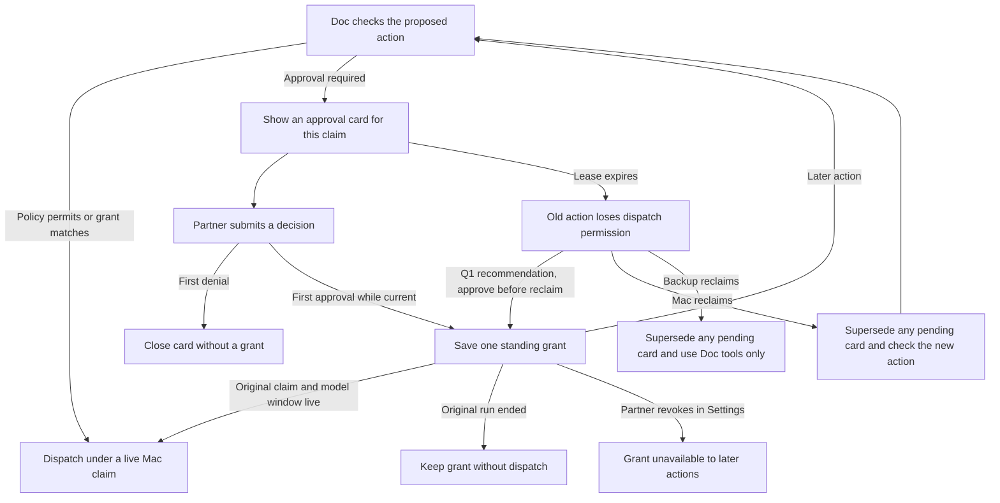
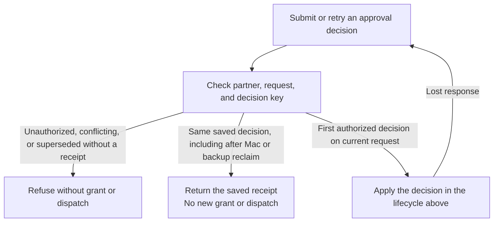
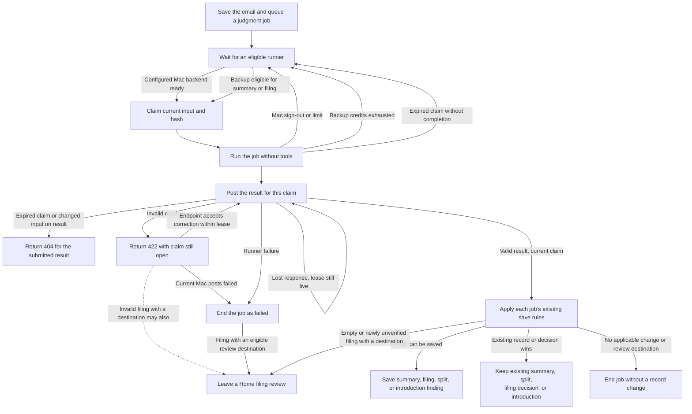

# Doc flows

Steps describe the stored outcome as well as what the partner sees. All app reads use the signed-in partner. App writes also check the usual write proofs. Signed-out calls ask the partner to sign in. Requests for another partner's private records look unavailable. [Partner calls](../new-database.md#partner-calls)

## F1 Ask

The [completion](#f3-answer-or-fail) and [save](#f4-propose-and-confirm) diagrams continue after a runner claims the turn.

1. The partner sends a nonblank question up to 4,000 characters with a new ask key. A deal, lead, client or exact mail activity can be supplied as context. A draft review supplies its exact draft ID and version. The engine checks access and saves the validated draft binding with its email activity and mailbox IDs. An unknown or foreign draft returns 404. A changed version or finished draft needs a fresh review.
2. The engine saves the question, context, key and position as `queued`. First send creates the conversation in the same transaction. The same key and request replay the saved turn. Changing the request under that key gives `key_reuse`. With the current turn contract, a new key in a busy chat gives `turn_in_progress`. The next-question feature uses the separate [waiting turn contract](../new-database.md#the-next-question).
3. A ready Mac takes the oldest queued or expired turn ahead of mail jobs, under one active lease per partner. The engine commits `working`, claim ID, deadline and empty claim evidence. The driver gets context, up to 12 prior answered turns, and only relevant preferences when available. The model and reads have up to 45 seconds within the 60-second lease. Four calls are available across the claim's read tools, including `find`, `read`, `mail_priorities`, `read_mail`, `read_playbook` and `read_guidance`. The claim tracks their count and authorized sources. An expired claim returns to the same queue position with a new claim ID and fresh evidence.
4. While queued or working, Ask Doc reloads the saved state. A reload or device change shows the same turn. A partner switch clears the prior partner's view. For an expired session return to sign-in. For an unknown chat show **Conversation unavailable**. For an old chat link whose history was discarded, offer **New chat**. The [live answer and Stop contract](../new-database.md#live-answer-and-stop) owns partial text, cancellation, and racing completion when that unit lands.

## F2 Clarify

1. Resolve the exact supplied ID or search by name. For competing matches ask the partner to choose with accessible match chips. For same-name deals, show the recorded phase and owner returned by Global Search when available. If those facts leave chips indistinguishable, number the remaining matches in the order returned and ask the partner to open the exact linked records before choosing. Missing fields stay blank. For a missing or inaccessible record ask for a record the partner can open. For mail require the exact activity ID and mailbox review. A thread label alone supplies no exact target.
2. The engine saves `answered` with kind `clarification`, its plain text and any authorized choices. The app shows no save card. The partner can supply the exact choice as a new question in the same chat. The next claim reads the record again. The latest clarification shows the existing waiting marker.

## F3 Answer or fail

This continues the [ask flow](#f1-ask). A stored proposal opens the [save flow](#f4-propose-and-confirm).

1. Read current engine facts for DoctorCRE claims. Use history to resolve references. Read relevant approved playbooks and guidance through `read_playbook` and `read_guidance` using topic and recorded context. Use the exact deal for applicable to-dos. Say when relevant guidance is unavailable. [Playbook reads](playbooks.md#read-approved-playbooks-and-guidance) If the evidence is insufficient, clarify or say what is unavailable. Unsupported app changes get a plain refusal. The engine resolves source keys for this claim into its own labels and links. It checks the result again at completion. A general or local result can have zero DoctorCRE sources when the claim has no Doc sources and the answer has no proposal. A refusal has no proposal or sources. In P1 plain text, quote only numbers and dates in the returned facts. The engine checks source IDs and proposal targets. Staging checks whether the text matches the evidence. For example, if a read returns 10 and the prose says 11, that fails the staging comparison. Automated numeric checking applies to structured chart points under decision 220. Label any computed dates as expected. [Visual answers](../new-database.md#visual-answers)
2. An accepted completion saves one `answered` turn with plain text, sources, provider and optional proposal. The engine pins the knowledge revisions supplied as evidence in `doc_knowledge_revision`. The app shows exact chips and the provider label for Codex, later providers, or backup. A read failure fails the turn. An invalid answer returns 422 and leaves the claim open. The endpoint accepts a corrected answer within the lease. The current Mac runner instead posts a failed completion on its next attempt within the lease. A missing, foreign, expired or completed claim returns 404. A lost completion is retried with the same claim inside the lease. A runner that cannot complete leaves the lease to expire.
3. A failed question stays visible. **Retry** for the latest eligible failure sends the original request and key, including the original omission of the conversation ID for the first question. It requeues the same turn. A superseded failure stays in history. For a changed or gone draft, open fresh review. A failed read of the chat list or conversation offers a read retry. The app shows the last saved state after reconnecting.

## F4 Propose and confirm

1. Doc uses `propose_save` with an authorized exact source. The proposal is stored in the answered turn when the engine accepts the answer. This step saves no business record. Ask Doc shows one editable card. A partner can leave it pending.
2. On **Save note**, **Save next step**, **Save draft and open review**, or **Save revision**, the app sends the turn ID, a separate save key, and edits. The engine locks the turn and rechecks the current target, owner, permission and applicable version. It commits the record or unchanged-draft result, save receipt and turn confirmation together. A note goes to Activity. The confirming partner owns a new step. An existing open step blocks the insert and links to that record.
3. A new reply is pending at version 1. If a draft already exists for that email, or a pending draft exists for that mailbox and Outlook conversation, return that exact draft unchanged. The app links to its review and says the new text was left unused. A revision updates only the subject or body on the exact pending version and returns the new version. A new draft or revision opens that exact review even when another card leads Home.
4. A lost save response retries the same key and edits and returns the receipt once. A changed request under that key gives `key_reuse`. Another key on a confirmed proposal gives `already_confirmed`. No proposal gives `no_proposal`. For a stale target or step keep the edits and link to the record. For a changed or finished draft keep the edits and direct the partner to fresh review.
5. Review supplies recipients and displays the saved draft. **Send reply** is a separate submission using the existing draft ID, version, recipient and outbox rules. Approval freezes the submitted values. The outbox handles delivery under door 22, which distinguishes retryable failure before dispatch from an unconfirmed delivery attempt. [Reply drafts and delivery](../new-database.md#22-reply-drafts-and-their-delivery)

## F5 Mac waiting and provider fallback

1. No credential shows setup. An issued credential with no recent poll for 30 seconds shows the Mac is off. A ready Mac with another claim shows the free-slot message. The question stays queued. A revoked credential stops that link's polling and completion.
2. If the chosen CLI reports sign-out or a plan limit, the engine stores that provider's readiness and reset when supplied, releases the lease and requeues the same turn. The ready second choice can claim it. If neither can answer, show the applicable waiting reason, provider name and reset time when known. The existing drivers check sign-in again after 30 seconds and retry a plan-limit check after five minutes when the CLI gives no reset time. A generic failed result stays a failure. [Picker](setup.md#ask-doc-picker)

## F6 Approve an action

An approval card belongs to its original claim. A standing grant can apply to later actions. The late decision branch shows the recommendation in [Q1](questions.md#q1-standing-grant-scope).

Check the decision receipt before treating a retry as a new decision. A reclaim supersedes a pending request and leaves an existing receipt readable.

1. The driver gives Doc the proposed action before dispatch. Doc checks its action type and scope against the signed-in partner's standing grants. A grant is a typed row with the partner's ID, action kind, scope and time granted. Run without a prompt if Doc's policy permits the action or an active grant covers it. The base CLI runs with its own restriction and approval layer off. A driver that cannot get a decision from Doc before dispatch cannot offer approval-controlled chat actions. The action types and interception mechanism need [Q1](questions.md#q1-standing-grant-scope).
2. When an action needs approval and has no grant, Ask Doc shows the action and the scope a standing grant would cover. The engine records a pending request bound to the partner, turn, claim and exact proposed action. The proposed action waits for the partner's decision in Ask Doc, including when they are away from the Mac. The partner's **Approve** writes a typed standing grant for that partner and scope. Settings lists the signed-in partner's active grants and lets that partner revoke them. No business record is written by the approval itself. Denial leaves no grant and the action does not run. An unauthorized decision cannot grant execution.
3. Resume only the approved action while the originating Mac claim and model window are both live. Use the same request and decision key when retrying a lost response. A repeated decision returns the saved result without creating another grant or dispatch. A conflicting decision changes neither. On a later request for the same kind of action within that grant, Doc rechecks the grant and runs it without asking again. Revocation takes effect before the next dispatch. F4 still owns committing a specific app save and submitting a reply. The relationship between standing grants and any future automatic business saves is in [Q3](questions.md#q3-business-confirmations).

4. Lease expiry ends dispatch permission immediately. An old card cannot authorize an action on a reclaimed Mac claim or on backup. A new Mac claim starts with current facts and independently checks existing grants before dispatch. Backup can only use its existing Doc tools. It cannot dispatch the Mac action or resume the approval.
5. [Q1](questions.md#q1-standing-grant-scope) keeps late grant storage open for the owner. The recommended behavior leaves an expired request visible as grant-only while it is still current. Approving it saves the grant once and dispatches nothing. The next Mac claim uses current facts before acting under that grant. The engine orders the grant decision and any reclaim under the same turn lock. If a Mac or backup claims the turn first, it supersedes the old request and the card closes without a grant. Show that a decision already recorded succeeded even if a new runner has since claimed the turn.

## F7 Unattended mail

Mail uses its own readiness check. Chat and mail share one active claim slot per partner.

1. Intake queues a job for the mailbox partner when an existing rule asks for judgment. It stores the job kind, exact email, owner and idempotency key, plus allowed destinations for filing. A Mac ready for that kind of mail job takes it after waiting chats, using the configured mail backend. It claims the current input and its hash. A job never appears in chat history.
2. Pass the job instructions separately from subject, body and any candidate destinations or introductions. The current mail runner gives mail no tools or link credential. The drawing keeps this behavior pending [Q2](questions.md#q2-unattended-mail). If the configured backend fails its mail checks, leave the job queued for an eligible runner. A ready chat provider does not make mail ready. A provider sign-out or limit requeues and records readiness. A changed input or expired claim cannot save. An invalid result returns 422 and leaves the claim open. The endpoint accepts a corrected result within the lease. An invalid filing can also create its Home review in the same attempt. The current Mac runner instead posts a failed completion on its next attempt within the lease. A failed completion ends the job under its existing rules.
3. Summary checks its quote and saves the first available summary of up to 300 characters, with an optional Home action title of up to 90 characters. Filing checks the exact quote, claimed destinations, sent-date vendor affiliation and prior filing decision before saving links and notes. Failed, invalid, empty or newly unverified filing leaves a Home review when there is a destination. Split stores the verified message and earlier text only while both fields are empty. Introduction checks an exact quote and the named parties against the claim. Accepted findings save as unconfirmed **Found in email** introductions. A matching recorded introduction wins. Lists and counts use confirmed introductions. Confirmation is later work under decision 224. [Mail jobs](../new-database.md#mail-judgment-jobs) · [Decision 224](../decisions.md)

## F8 Prepaid backup

1. When enabled, the minute dispatcher checks chat before mail, at most one item per partner per tick. A turn is eligible when the Mac is unready for chat or the turn has waited two minutes. Summary and filing use the same rule with Mac readiness for that mail kind. For example, with Claude ready for chat and the configured Codex backend unable to isolate mail, eligible summary and filing can go to backup on its next tick without the two-minute wait. Chat keeps its own readiness and wait. Requeued chat starts a fresh wait. For mail use creation time. Split and introduction stay Mac-only. The dispatcher takes the same slot and rechecks readiness and eligibility under lock before running.
2. Backup uses the same lease, model window, Doc reads and result checks. Its mail gets no tools. Accepted results follow F3 or F7. Backup chat is labeled **Answered by backup**. A backup claim cannot dispatch a pending Mac action. Apply the approval expiry and reclaim rules in F6. Failed work follows the ordinary failure or filing review path. With exhausted credits, requeue the work, stop sends for that tick, and preserve Mac readiness. If credits stay exhausted, later ticks send at most one request each. Work waits if neither runner can take it. [Doc backup](../new-database.md#doc-backup)

## F10 File or dismiss an exact email

1. Start with the authorized email activity ID. A Home filing review launch also supplies its exact `proposal_id`. If the partner starts with only the email, look up its visible pending filing suggestions in Home by source activity. Use the exact `proposal_id` from the authorized Home filing card, whose review key is `suggestion:<proposal_id>`. Ask the partner to select a review if more than one fits. A reply draft or another message in the thread cannot supply the filing proposal ID.
2. Read `GET /api/engine/proposals/{id}` and verify its source activity and mailbox. If eligible, show the evidence and available destinations. For **Choose deal**, preview the selected open deal and show the existing reason requirement. Doc shows the link to that exact proposal. If the partner asks Doc to dismiss it, open or link to the same pending review. The request in chat leaves the proposal, filing and sibling reviews untouched.
3. The signed-in partner accepts or dismisses in Home. The app submits `POST /api/engine/proposals/{id}/decision` with that exact proposal ID, the partner's write proofs and its save key. Send the selected destination and any required filing reason on acceptance. A dismissal needs the partner's reason. A confirmed filing saves through door 21. A confirmed dismissal records the disposition and removes the review and its superseded siblings from Home. A same-key retry replays the receipt. A new decision on an already settled review returns `already_decided`. With no eligible review, follow [Q5](questions.md#q5-filing-without-a-review).
