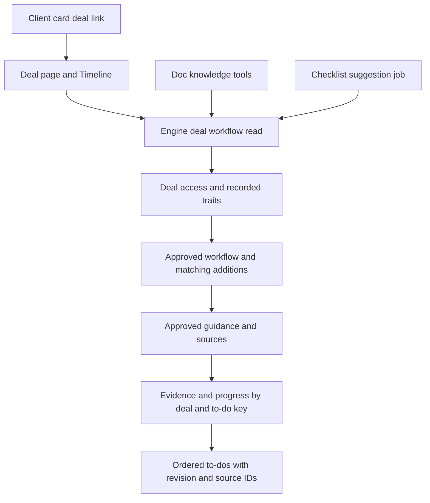
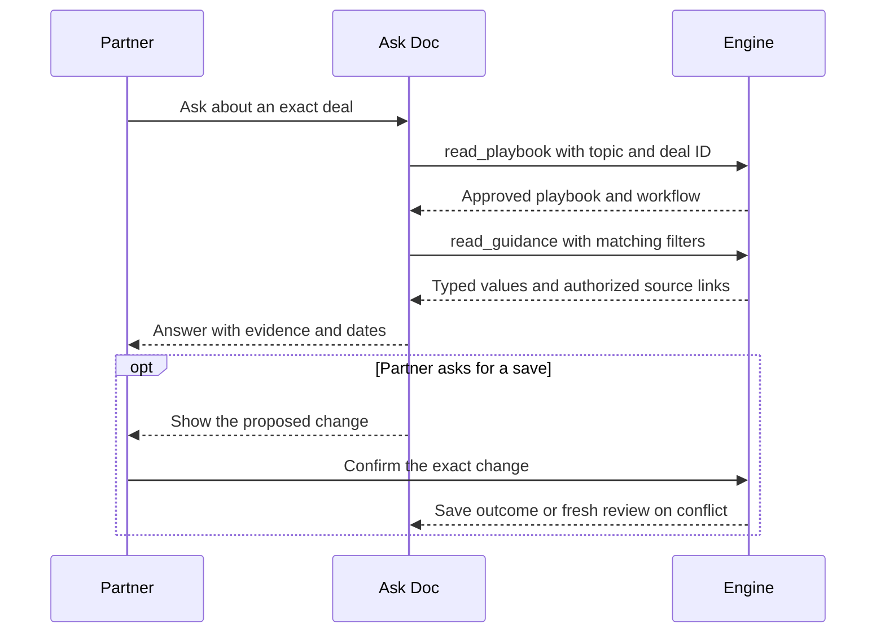
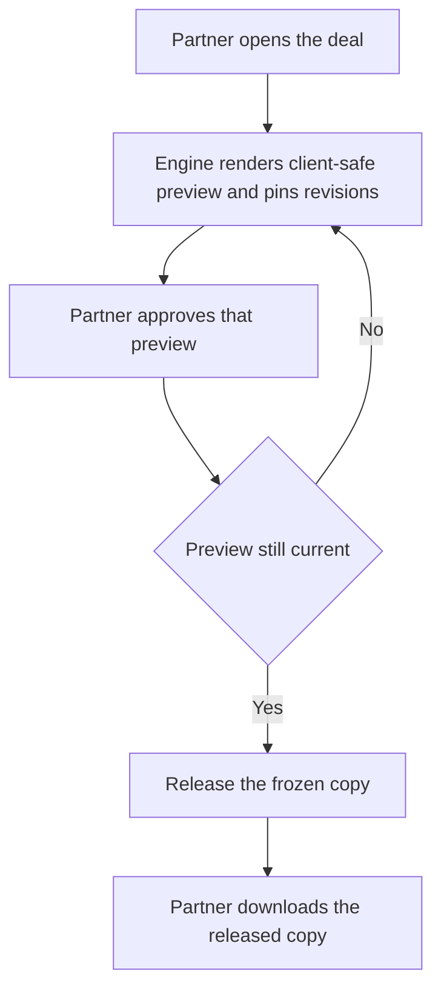

# What people and jobs read

## Open the deal workflow

1. Resolve access and read the deal's kind, renewal facts, market and client role in one consistent transaction. Read the client's recorded practice type and practice stage. Read the deal phase for display and placement. A missing trait never matches a named selector.
2. Pick the workflow with the existing checklist selection rules. Resolve its current approved revision as of today in Central time. Include every common to-do, plus eligible additions. Selectors on a row all have to match. One matching scope row is enough for a knowledge revision. With no scope, the revision is general. Use the existing eight-phase order, then the position within each phase. Read the same version for both the plan and guidance on that deal.
3. On each to-do, return the guidance attached to it with measure, unit, values or calculated ratio, last checked date, and accessible sources. General guidance and workflow-wide guidance are available in the same read's reference section. Show effective date and source date so observations from different periods are distinct. A lender's program terms come from approved term revisions. Count distinct deals where the lender was chosen and how many of those deals closed, from authorized past deal participation. Two applicable sourced estimates may differ. Display each with its conditions and evidence.
4. Join recorded evidence and progress by deal and to-do key. Keep progress when a kind or workflow changes. Hide it while the key is absent and show it again if the key returns. For an override on the same to-do and guidance revision, prefer the deal's over the client's. An override shows the original sourced value, the replacement, and the reason to the partner. A skip keeps the to-do in place with its reason. Show completion when a to-do has both a completion and a skip. A settlement suppresses suggestions for that key. The read omits skipped work from the next suggestion and forecast chain. Existing steps, critical dates, phase history and recorded dates still come from their records.
5. Return each to-do's stable key, workflow revision, phase, position and completion state. Return knowledge item IDs and versions with the same read. Keep draft and reference rows in the review and history read. When a source is outside this caller’s access, omit its locator and the guidance that depends solely on it. A real read failure says the workflow is unavailable. A known workflow awaiting approval reports that state before the switch.

| Partner location                                                                        | What the partner sees and can do                                                                                                                                                                                                                                              |
| --------------------------------------------------------------------------------------- | ----------------------------------------------------------------------------------------------------------------------------------------------------------------------------------------------------------------------------------------------------------------------------- |
| [Deal page Overview](../screens/deals.md#overview) and [Plan](../screens/deals.md#plan) | Open a to-do to see its guidance and sources. Mark partner-checked work complete, record a reason to skip, or apply a value override. Show historical actions on the deal. Suggested and Timeline use the same to-do order.                                                   |
| [Client card](../screens/clients.md#a-clients-card)                                     | See recorded practice type and stage. Edit their approved keys here. Open each deal's workflow through its deal link. Propose a to-do or save a value override across that client's eligible deals.                                                                           |
| [Vendor card](../screens/vendors.md#a-vendors-card)                                     | Open a named lender program to see approved terms and sources beside its calculated track record. Propose term edits here. A vendor with only a recorded program name has no sourced terms yet.                                                                               |
| **Knowledge** in the app                                                                | Find by topic, kind, workflow, source, deal kind, practice type or stage. Open current, proposed, reference and past revisions with their dates and attribution. Edit a draft, propose it and approve, decline or retire a revision. Private means only the owner can see it. |
| [Deal page Client portal](../screens/deals.md#client-portal)                            | Preview the client copy, approve the exact preview and download it. The deal's existing website access follows its own rules.                                                                                                                                                 |

## Ask Doc or suggest the next to-do

Doc reads business playbooks and guidance only through the engine's claim-scoped `read_playbook` and `read_guidance` tools. The Doc role and engine code keep the access, tool, and confirmation rules. The engine checkout holds the drawing and tests. The approved typed rows supply the playbooks used at runtime. [Doc harness drawing](https://github.com/DoctorCRE/doctorcre-engine/pull/1514)

| Tool            | Input                                                                                                           | Returns                                                                                                                                                                              |
| --------------- | --------------------------------------------------------------------------------------------------------------- | ------------------------------------------------------------------------------------------------------------------------------------------------------------------------------------ |
| `read_playbook` | Any of `topic`, `deal_kind`, `practice_type`, or `deal_id`, plus optional `playbook_id` for a partner's choice. | Approved Doc playbook revisions with notes. A matching deal workflow returns the workflow notes, its ordered to-dos, and their notes, with progress for an exact deal.               |
| `read_guidance` | The same filters and optional `cursor`.                                                                         | Approved applicable rules, procedures, rubrics, doctrine, rules of thumb, market observations, and lender terms, with typed values, dates, plain-text notes, and accessible sources. |

Require at least one filter. Validate topic, deal kind and practice type against their stored keys. With a deal ID, require an authorized deal from the current claim or trusted app subject. Derive the deal's traits, market and client from that deal. Reject supplied filters that conflict with its recorded known traits. Treat an unknown trait as missing when matching a named selector. Without a deal, match the supplied trait keys and general rows. Omit scopes that require a specific client, deal, market or stage. An exact topic returns only rows linked to it. With no topic filter, return the matched rows with their topic keys.

Each call uses one existing Doc read slot. For each matched topic, `read_playbook` returns one approved Doc playbook. Rank each candidate by its best matching scope, comparing exact deal, client, market, practice type, practice stage, and deal kind in that order. At the first difference, a named match beats a missing selector. If distinct playbooks tie for first, return their accessible titles and IDs for Doc to ask which to use. After the partner chooses, accept that ID as `playbook_id` only if it is still an accessible top match under the same filters. Return up to ten topics in key order and ask Doc to narrow the request if there are more. The deal workflow is picked separately by the checklist selection rules and returns all its applicable ordered steps.

`read_guidance` returns up to ten distinct matching revisions per page. Order by first matching topic key, title, and item ID. A further page uses the returned `next_cursor` and the same filters. The cursor is opaque, tied to the current claim and filters, and advances past the last returned sort key. Recheck access on every page. If matching revisions or access change, tell Doc to restart the query. Only return a cursor when another page exists. Narrow the filters if the claim runs out of reads.

Both tools return stable item IDs and versions and register accessible sources in the claim. Keep the pins for what was supplied to the answered turn. A later turn reads current revisions. An inaccessible or failed read reports unavailable. An empty match tells Doc it has no approved playbook or guidance for that request.

Only a partner request or trusted app context starts a workflow. Source text and notes are plain-text evidence. The existing doors check eligibility, evidence and confirmation. Jobs consume the same shared projection. The checklist suggestion job picks the first eligible unfinished to-do for the current phase. A decided suggestion settles that deal and to-do key. Renaming the to-do or switching workflows or deal kinds leaves the settlement intact. The job skips settled keys when they are visible again. The original proposal wording and decision remain in history. A job may prepare a sourced draft for partner review.

## Release a client copy

Show the applicable to-do labels and approved shared typed guidance values in the agreed units. Omit revision and step notes, skips, overrides, internal locators, and private knowledge. The proposed copy leaves progress and dates in the partner view. The engine renders again from a consistent live read at release and compares the result and revision list with the prepared preview. A resumed export returns the same released bytes. A new client copy starts from the current live read.
