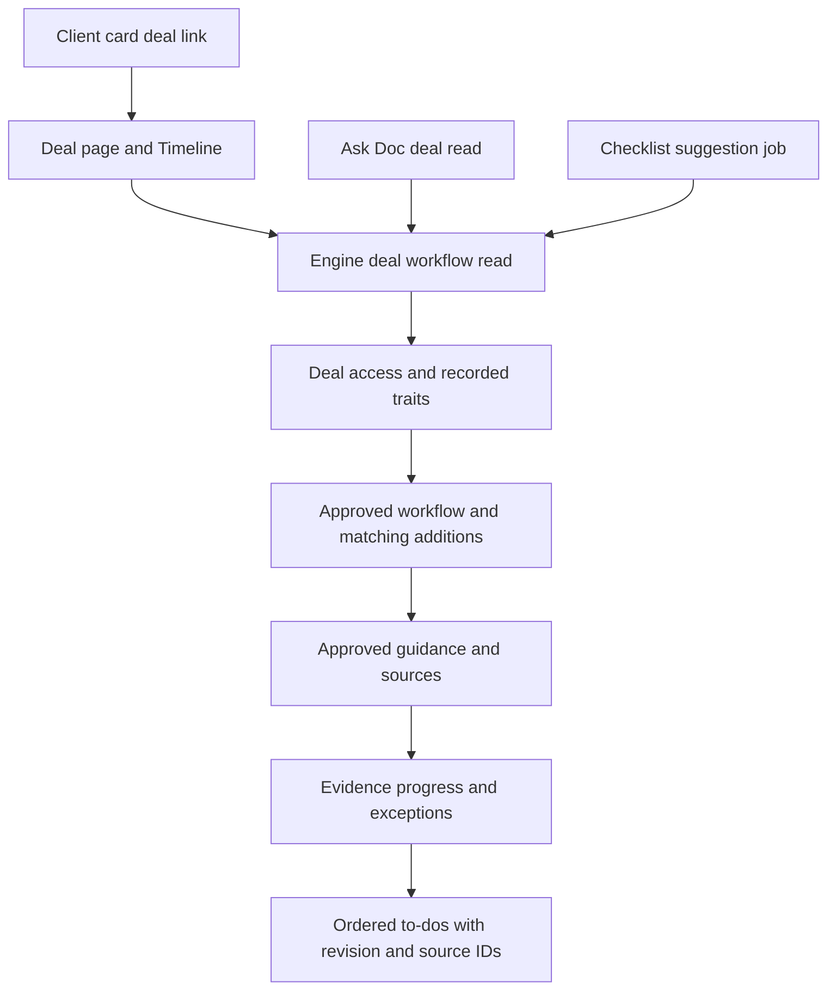
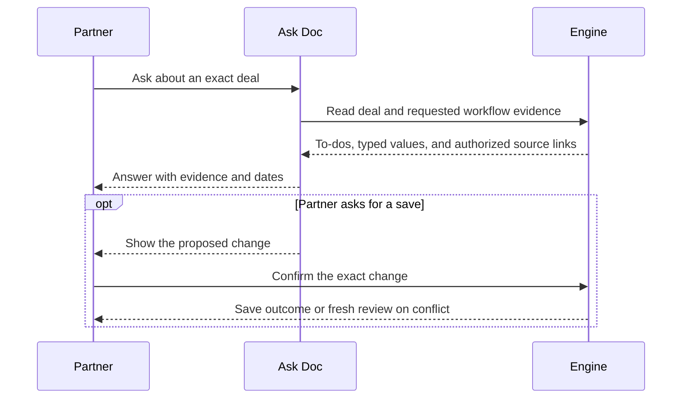
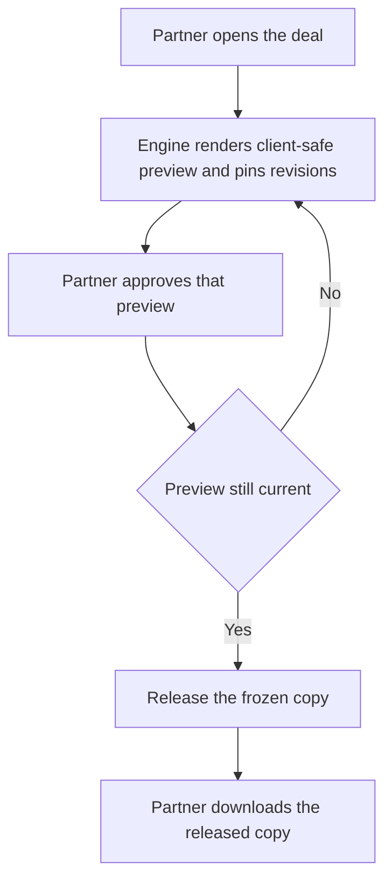

# What people and jobs read

## Open the deal workflow

1. Resolve access and read the deal's kind, renewal facts, market and client role in one consistent transaction. Read the client's recorded practice type and practice stage. Read the deal phase for display and placement. A missing trait never matches a named selector.
2. Pick the workflow with the existing checklist selection rules. Resolve its current approved revision as of today in Central time. Include every common to-do, plus eligible additions. Selectors on a row all have to match. One matching scope row is enough for a knowledge revision. With no scope, the revision is general. Use the existing eight-phase order, then the position within each phase. Read the same version for both the plan and guidance on that deal.
3. On each to-do, return the guidance attached to it with measure, unit, values or calculated ratio, last checked date, and accessible sources. General guidance and workflow-wide guidance are available in the same read's reference section. Show effective date and source date so observations from different periods are distinct. A lender's program terms come from approved term revisions. Count distinct deals where the lender was chosen and how many of those deals closed, from authorized past deal participation. Two applicable sourced estimates may differ. Display each with its conditions and evidence.
4. Join recorded evidence and saved completion. For each applicable exception prefer the deal's over the client's for the same action and target. An override shows the original sourced value, the replacement, and the reason to the partner. A skip keeps the to-do in place with its reason. A completed to-do keeps its completion, and any existing skip stays in history. The read omits skipped work from the next suggestion and forecast chain. Existing steps, critical dates, phase history and recorded dates still come from their records.
5. Return each to-do's stable slug, workflow revision, phase, position and completion state. Return knowledge item IDs and versions with the same read. Keep draft and reference rows in the review and history read. When a source is outside this caller’s access, omit its locator and the guidance that depends solely on it. A real read failure says the workflow is unavailable. A known workflow awaiting approval reports that state before the switch.

| Partner location | What the partner sees and can do |
| --- | --- |
| [Deal page Overview](../screens/deals.md#overview) and [Plan](../screens/deals.md#plan) | Open a to-do to see its guidance and sources. Mark partner-checked work complete, record a reason to skip, or apply a value override. Show historical actions on the deal. Suggested and Timeline use the same to-do order. |
| [Client card](../screens/clients.md#a-clients-card) | See recorded practice type and stage. Edit their approved keys here. Open each deal's workflow through its deal link. Propose a to-do or save an exception that should apply across that client's eligible deals. |
| [Vendor card](../screens/vendors.md#a-vendors-card) | Open a named lender program to see approved terms and sources beside its calculated track record. Propose term edits here. A vendor with only a recorded program name has no sourced terms yet. |
| **Knowledge** in the app | Find by kind, workflow, source, practice type or stage. Open current, proposed, reference and past revisions with their dates and attribution. Edit a draft, propose it and approve, decline or retire a revision. Private means only the owner can see it. |
| [Deal page Client portal](../screens/deals.md#client-portal) | Preview the client copy, approve the exact preview and download it. The deal's existing website access follows its own rules. |

## Ask Doc or suggest the next to-do

Use the existing exact deal read in Ask Doc. Its workflow projection counts as part of that read, uses the turn owner's access, and returns current to-dos and evidence for the request. The engine gives Doc source links from authorized results and stores the revision pins for the answered turn. A later question reads current facts and can cite a newer version. A failed knowledge read says the relevant guidance is unavailable. It never produces a made-up value.

The [Doc instructions](https://github.com/DoctorCRE/doctorcre-engine/blob/93a4540bac1848f4f0b33d985b31918c8502b1db/docs/doc-harness/playbooks.md) still govern triggers, tool calls, access checks, exact evidence and confirmed saves. Knowledge prose is evidence. It cannot start a tool call or grant access. Jobs consume the same shared projection. The checklist suggestion job picks the first eligible unfinished to-do for the current phase. A job may also prepare a sourced draft for the partner to consider. Its draft has no approval authority.

## Release a client copy

Show the relevant common and added to-dos and any shared guidance with approved client wording. Include client text from the revision and display typed values in the agreed units. Omit internal notes, skips, overrides, internal locators, and private knowledge. The proposed copy leaves progress and dates in the partner view. The engine renders again from a consistent live read at release and compares the result and revision list with the prepared preview. A resumed export returns the same released bytes. A new client copy starts from the current live read.
