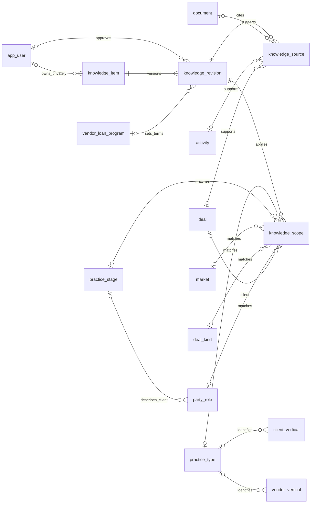
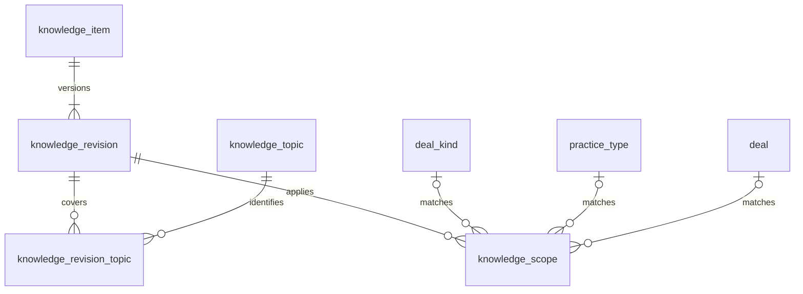
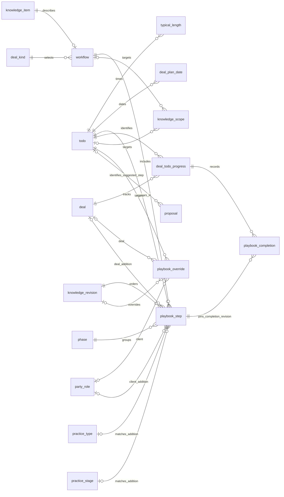
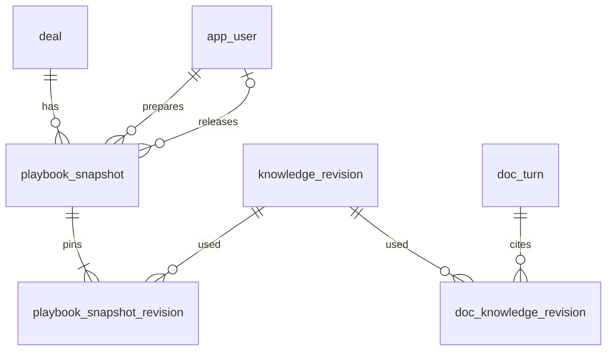

# Tables and constraints

These are proposed tables in `next`. Columns are required unless marked `?`. UUID primary keys default to `gen_random_uuid()` and new timestamps default to the transaction time unless supplied by history import or set by a transition. Dates and numbers are finite. Slugs are lowercase letters, digits and underscores, starting with a letter. Labels, reasons and other supplied text must contain a nonspace character. Foreign keys restrict deletion unless the existing merge contract calls for moving a link.

Every new table and every changed existing table uses the [change stamps](../new-database.md#users-jobs-and-who-changed-what) and `record_change`. The four stamp columns are `changed_at timestamptz`, `changed_by_user_id uuid? → app_user`, `changed_by_job text? → job`, and `changed_for_user_id uuid? → app_user`. The transaction supplies the actor. Keep the existing distinction between a partner and a job working for one.

## Practice traits and knowledge

| Table                                         | Columns and keys                                                                                                                                                                                                                                                                                                                                                                                                                                                                                                                                                                                                                                                                                                                           |
| --------------------------------------------- | ------------------------------------------------------------------------------------------------------------------------------------------------------------------------------------------------------------------------------------------------------------------------------------------------------------------------------------------------------------------------------------------------------------------------------------------------------------------------------------------------------------------------------------------------------------------------------------------------------------------------------------------------------------------------------------------------------------------------------------------ |
| `practice_type`, `practice_stage`             | Each has `slug text PK`, `label text UNIQUE`. A practice stage is a business trait, such as starting or established.                                                                                                                                                                                                                                                                                                                                                                                                                                                                                                                                                                                                                       |
| Existing `client_vertical`, `vendor_vertical` | Add `practice_type text? → practice_type` to each. Keep existing keys and text. A matched type supplies applicability. The client edit carries the current approved key through a subtype-only save. When the recorded type changes, save its reviewed matching key or clear the key if the new type is unmatched.                                                                                                                                                                                                                                                                                                                                                                                                                         |
| Existing `party_role`                         | Add `practice_stage text? → practice_stage`. A check allows it only on the client role. A client can record a stage before a practice type is known.                                                                                                                                                                                                                                                                                                                                                                                                                                                                                                                                                                                       |
| `knowledge_item`                              | `id uuid PK`, `kind text` from `workflow`, `playbook`, `rule_of_thumb`, `market_observation`, `lender_term`, `company_rule`, `doctrine`, `procedure`, `rubric`, or `lesson`, `private_to_user_id uuid? → app_user`. Null means shared. Kind and visibility are fixed.                                                                                                                                                                                                                                                                                                                                                                                                                                                                      |
| `knowledge_revision`                          | `item_id uuid → knowledge_item`, `version integer > 0` (together PK), `title text`, `notes text?`, `status text` from `draft`, `proposed`, `approved`, `declined`, `retired`, or `reference`, `effective_on date?`, `last_checked_on date?`, `approved_by_user_id uuid? → app_user`, `approved_at timestamptz?`, `import_key text? UNIQUE`. Typed columns below.                                                                                                                                                                                                                                                                                                                                                                           |
| `knowledge_source`                            | `id uuid PK`, `item_id uuid, version integer → knowledge_revision`, `observed_on date?`, `locator text?`, `document_id uuid? → document`, `activity_id uuid? → activity`, `deal_id uuid? → deal`. Exactly one locator or record reference. `UNIQUE NULLS NOT DISTINCT` on revision and the four locator columns. A locator identifies an exact publication, dated export record, or checked-in definition.                                                                                                                                                                                                                                                                                                                                 |
| `knowledge_scope`                             | `id uuid PK`, `item_id uuid, version integer → knowledge_revision`, `deal_kind text? → deal_kind`, `practice_type text? → practice_type`, `practice_stage text? → practice_stage`, `market_id uuid? → market`, `client_party_id uuid?`, `client_role text` generated as `client`, `deal_id uuid? → deal`, `workflow_id uuid? → workflow`, `todo_key text? → todo`. Client pair references `party_role`. At least one selector. If a scope names both a workflow and a to-do, both match the current workflow step. Unique selectors per revision with nulls equal. If a scope names a deal and a client or deal kind, they must match the deal at save. Later changes leave the approved scope intact and require both selectors to match. |

A revision's typed columns are `measure text?`, `unit text?`, `amount numeric?`, `upper_amount numeric?`, `denominator numeric?`, `denominator_unit text?`, `vendor_party_id uuid?`, `loan_program text?`, and `expires_on date?`. The program pair references `vendor_loan_program(party_id, loan_program)`. One lender term revision holds one comparable term. Conditions that the engine can match are scope fields. Every revision can carry plain-text notes for judgment, exceptions, examples, and nuance. Keep facts queryable in their typed columns and links.

| Kind                                           | Typed checks                                                                                                                                                                                                                                                                                                                                                                                                                                                                            |
| ---------------------------------------------- | --------------------------------------------------------------------------------------------------------------------------------------------------------------------------------------------------------------------------------------------------------------------------------------------------------------------------------------------------------------------------------------------------------------------------------------------------------------------------------------- |
| Rule of thumb, market observation, lender term | Require measure, unit and amount. A range has `upper_amount > amount`. A ratio uses a positive denominator with a denominator unit. Keep numerator and denominator as measured. Require at least one scope with a market for an observation and a market on every one of its scopes. Require both program columns for a lender term only. A lender term may have an exclusive expiry after its effective date. A market observation requires at least one dated source before approval. |
| Company rule, procedure, rubric                | Require notes. A rule also has a scope row, such as a workflow or a to-do. The notes describe the practice or judgment. Existing engine code and constraints govern actions.                                                                                                                                                                                                                                                                                                            |
| Playbook, doctrine, lesson, workflow           | A playbook, doctrine item, or lesson requires notes. Lessons have reference status when sealed. The deal workflow has separate ordered step rows.                                                                                                                                                                                                                                                                                                                                       |

For the first use, the measure and unit pairs are `space_per_operatory` (square feet per operatory), `asking_rent` (USD per square foot per year), `vacant_area` (square feet over surveyed square feet), `loan_amount` (USD), `loan_term` (months), `ltv` (fraction), and `minimum_dscr` (ratio). The database checks measure and unit pairs by item kind, required denominators, nonnegative amounts, positive whole months, vacancy numerator at most the surveyed area, and LTV within zero and one. Calculated vacancy is vacant area divided by surveyed area. A denominator is accepted only for the measure that calls for an observed denominator.

### Topics and Doc playbooks

| Table                      | Columns and keys                                                                                                                                             |
| -------------------------- | ------------------------------------------------------------------------------------------------------------------------------------------------------------ |
| `knowledge_topic`          | `slug text PK`, `label text UNIQUE`. Start with `deal_workflow`, `deal_follow_up`, `email_reply`, and `email_filing`.                                        |
| `knowledge_revision_topic` | `item_id uuid, version integer → knowledge_revision`, `topic text → knowledge_topic` (all three PK). Topic links inherit revision access and freeze with it. |

Approval requires a topic for each playbook, workflow, or guidance revision. A Doc playbook keeps its judgment and guidance in the revision's notes. The notes can describe the context and choices a partner should consider. The engine's tool and confirmation contract governs execution.

The first three playbooks cover deal follow-up, exact-email reply, and exact-email filing. The shared deal workflow also links to `deal_follow_up` so that one call can return the follow-up playbook and the deal to-dos. Email playbooks can be general. Deal playbooks and guidance can have scopes by deal kind, practice type and exact deal. A topic link answers what a revision covers. The scope answers where it applies. Both may change with a new approved revision.

### Approval and history

Each item has one sequential revision chain. Revision 1 starts it and version N supersedes N minus 1. Allocate versions under an item row lock and allow one unsealed draft or proposal per item. Partner edits and job suggestions land in drafts. A direct partner submits a draft, then approves it or declines it. A direct partner can revise by creating a new draft or retire an item by approving a retirement revision. Private items are limited to their owner, and either partner can propose or decide shared items, including their own proposal. An approval or retirement sets the actor and time once. A pending write checks the expected revision or status and rejects stale saves.

Allow only the draft to be edited. A proposal freezes its content, scopes, sources, topic links, and playbook steps. A database transition guard and deferred constraints check the kind's payload, scope, source and topic rules, the existing partner role, the current version, and the allowed status transition. Approval requires at least one source, a last-checked date, and an effective date. A retirement records its reason in notes and goes through the same actor, source, and date checks. Require last checked no later than approval and source observation no later than last checked when the dates are known. Approved and retirement effective dates never go backward in a chain. A same-day revision with the higher version wins. Live readers pick the highest approved or retirement version effective on the business day. Retirement or a term past expiry contributes no live guidance. Expiry does not revive an older revision. Reference rows are readable as history or lessons. Declines retain the proposal and its actor in `change`. They do not advance the live version.

## Workflows and progress

| Table                                       | Columns and keys                                                                                                                                                                                                                                                                                                                                                                                                                                                                                                                                                                                                                                                                                                          |
| ------------------------------------------- | ------------------------------------------------------------------------------------------------------------------------------------------------------------------------------------------------------------------------------------------------------------------------------------------------------------------------------------------------------------------------------------------------------------------------------------------------------------------------------------------------------------------------------------------------------------------------------------------------------------------------------------------------------------------------------------------------------------------------- |
| `workflow`                                  | `id uuid PK → knowledge_item` of kind workflow, `deal_kind text → deal_kind`, `selector text` from `standard`, `renewal`, and `fallback`, unique kind and selector. Only `lease` uses renewal and only `other` uses fallback. Workflow items are shared.                                                                                                                                                                                                                                                                                                                                                                                                                                                                  |
| `todo`                                      | `key text PK`, `completion_mode text` checked to be `evidence`, `partner_checked`, or `timing_only`. The key and mode stay fixed. A to-do has one key across all workflows and deal kinds.                                                                                                                                                                                                                                                                                                                                                                                                                                                                                                                                |
| `playbook_step`                             | `workflow_id uuid → workflow`, `version integer`. The workflow and version pair references `knowledge_revision(item_id,version)`. `todo_key text → todo` (triple PK), `phase text → phase`, `position integer > 0`, `label text`, `common boolean`, `notes text?`, `practice_type text? → practice_type`, `practice_stage text? → practice_stage`, `client_party_id uuid?`, `client_role text` generated as `client`, `deal_id uuid? → deal`. Position is unique within phase and revision. The phase must be one of the eight ordered checklist phases. Client pair references `party_role`. Common rows have no selectors. Additions have at least one selector. A client or deal addition records its reason in notes. |
| Existing `typical_length`, `deal_plan_date` | Add FK `todo → todo(key)` after checking every current key. Preserve the kind on typical lengths and the deal on plan dates. `before_research` stays a timing-only key.                                                                                                                                                                                                                                                                                                                                                                                                                                                                                                                                                   |
| Existing `proposal`                         | Add nullable `todo_key text? → todo`. Other proposal kinds leave it null. Workflow suggestions require it after cutover. Proposal history retains the original wording and decision.                                                                                                                                                                                                                                                                                                                                                                                                                                                                                                                                      |
| `playbook_override`                         | `id uuid PK`, `todo_key text → todo`, `client_party_id uuid?`, `client_role text` generated as `client`, `deal_id uuid? → deal`, `item_id uuid, version integer → knowledge_revision`, `amount numeric`, `upper_amount numeric?`, `reason text`, `ended_at timestamptz?`. Client pair references `party_role`. Exactly one client or deal. One live override per target, to-do, and quantitative revision with nulls equal.                                                                                                                                                                                                                                                                                               |
| `deal_todo_progress`                        | `deal_id uuid → deal`, `todo_key text → todo` (together PK), `settled boolean` default false, `skip_reason text?`, `completed_at timestamptz?`. A skip requires a nonblank reason. The proposal decision and settlement save in one transaction.                                                                                                                                                                                                                                                                                                                                                                                                                                                                          |
| `playbook_completion`                       | History only. `id uuid PK`, `deal_id uuid, todo_key text → deal_todo_progress`, `workflow_id uuid, version integer, todo_key text → playbook_step`, `completed_at timestamptz`. The versioned FK records what the partner checked.                                                                                                                                                                                                                                                                                                                                                                                                                                                                                        |

The approval constraint rejects a workflow with zero common to-dos or a revision that loses or retags a previously approved common key. Workflow items cannot retire. The first approved revision must include the approved baseline keys for its selector. A database constraint locks the owning item when checking a revision and all its member rows. Freeze the whole approved ordering. Seed the lease and purchase standard workflows and the existing renewal order under lease. A recorded renewal uses the renewal order. An imported renewal with its old lease unrecorded falls back to the current standard kind as it does today. If the current engine cannot pick a template, use the fallback with its existing unconditional to-dos and carry forward its unknown-kind indicator. Keep old-system readers on their current templates until their own switch. The old land checklist remains a source for owner review until a new kind mapping is approved.

Install the nullable proposal key before upgrading the writer. Keep the current reader until old writers drain. Lock proposal writes, finish the [one-time mapping](import.md#map-existing-to-dos), and enforce the required key in that transaction. Switch to the new progress read after reconciliation and enforcement.

Workflows choose which keys appear and their order. Deal progress uses `(deal_id, todo_key)` even if the workflow or kind changes. Changing the selection hides progress for an absent key. If the key returns, so does its progress. A partner skips a deal to-do with a reason. Value overrides stay attached to their exact guidance revision and must pass its measurement checks.

A database trigger locks the deal and checks that a manual completion is for an applicable, currently approved `playbook_step` and a stable `todo` with mode `partner_checked`. It saves progress and its history row in one transaction. Reopening clears completion on the progress row and keeps the history. Evidence-backed to-dos keep their existing record checks. Timing-only keys cannot appear in `playbook_step`.

A duplicate client merge preserves the reviewed practice type when the survivor has none. If both client records have different reviewed keys, stop and ask a partner. Apply the same check to different recorded stages. Move client addition and override links to the surviving client role. Conflicting live overrides wait for a partner. Vendor merges preserve term revisions and sources when rekeying identical named programs. Existing merge attribution applies.

## Snapshots and Doc sources

| Table                        | Columns and keys                                                                                                                                                                                                                                                                                                                               |
| ---------------------------- | ---------------------------------------------------------------------------------------------------------------------------------------------------------------------------------------------------------------------------------------------------------------------------------------------------------------------------------------------- |
| `playbook_snapshot`          | `id uuid PK`, `deal_id uuid → deal`, `prepared_by_user_id uuid → app_user`, `prepared_at timestamptz`, `content text`, `released_by_user_id uuid? → app_user`, `released_at timestamptz?`. Content is the exact client-facing text reviewed and exported. Release actor and time are both null or both set, with time at or after preparation. |
| `playbook_snapshot_revision` | `snapshot_id uuid → playbook_snapshot`, `item_id uuid, version integer → knowledge_revision` (all three PK). Every snapshot pins its workflow and the guidance used in the rendered copy.                                                                                                                                                      |
| `doc_knowledge_revision`     | `turn_id uuid → doc_turn`, `item_id uuid, version integer → knowledge_revision` (all three PK). Store revisions the engine supplied as evidence for the answered turn. This row follows the turn's deletion policy and access.                                                                                                                 |

Creation fixes snapshot content and its revision links in one transaction. The release transaction checks the exact snapshot and requires a direct partner, an accessible deal, and current, approved, shared revisions. The snapshot renderer includes applicable to-do labels and approved shared typed guidance values. It uses the public display label for each measure. Deal and client overrides remain internal under the proposed release policy. Revision and step notes, record IDs, private sources, and internal source locators stay inside the practice. A change in the preview inputs before release requires a new preview. After release, the authorized export returns the same bytes even if live data changes. Release alone sends nothing.

## Row access and change history

Force row-level security on knowledge tables and deny unconditional reader and writer grants. Use the existing transaction identity and role-scoped engine doors. Scope, source, topic-link, and playbook step rows inherit the parent's visibility and status. Topic vocabulary follows the practice vocabulary's access rules. A signed-in partner can read shared history, their own private history, and deal or client links they can already open. Lookups of a source record or its display label use the source's own access rule. An inaccessible source never yields a title, URL, or record ID.

Doc reads under its turn's partner and current subject access. Its evidence links inherit the turn owner and the revision's visibility. Approved jobs get only the approved shared projection for their named task. A job that proposes a revision can only insert a shared draft through its door, stamped as that job. Approval, retirement, exceptions, manual completion, and release require a direct account partner. Scope, attribution and transition checks apply even to a write that bypasses the app. Vocabulary and stable workflow keys are readable to both partners. Only partner-approved changes to the vocabulary reach the database. Existing tables keep their access rules.

Snapshot versions and previews are visible through the exact deal to authorized partners. The export reads only the released artifact via the partner's door. Child rows and FK checks cannot be used to probe private IDs through that door. Restrict raw `change`, `save_receipt`, and history lookups for all new tables to the owner or a projection with the same row access. An ordinary history, job, export, or cross-partner Doc request cannot reveal private titles, source keys or counts.
