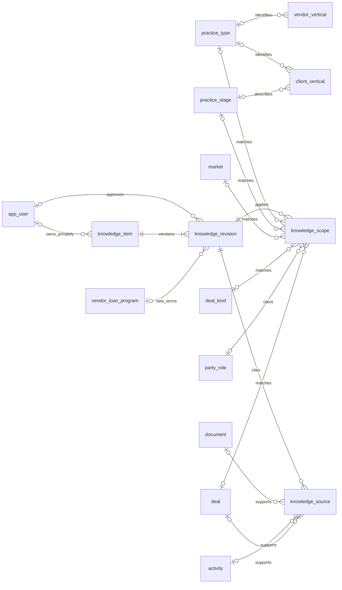
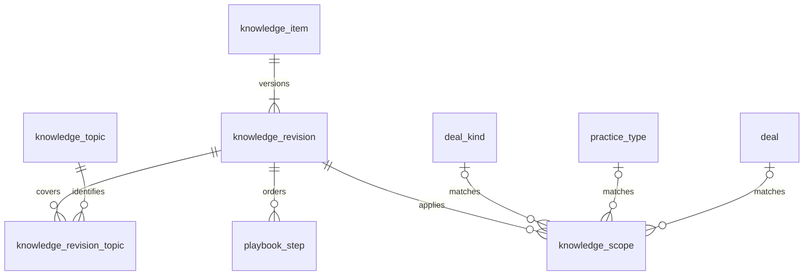
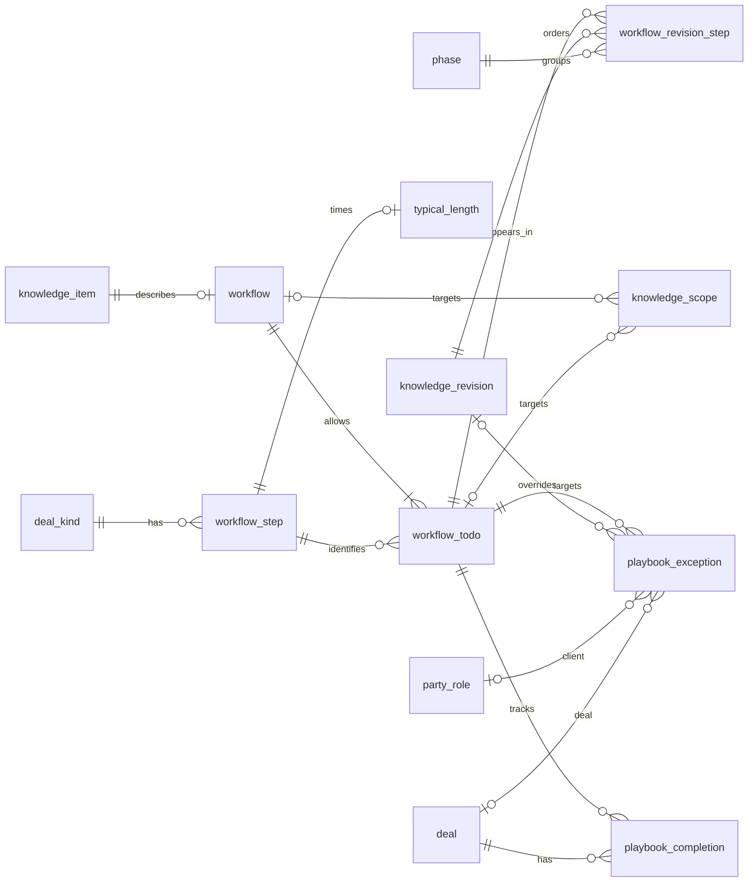
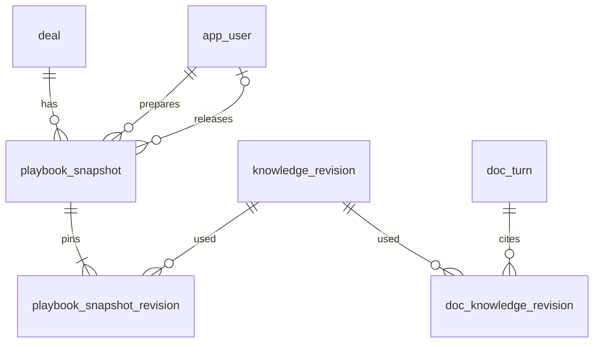

# Tables and constraints

These are proposed tables in `next`. Columns are required unless marked `?`. UUID primary keys default to `gen_random_uuid()` and new timestamps default to the transaction time unless supplied by history import or set by a transition. Dates and numbers are finite. Slugs are lowercase letters, digits and underscores, starting with a letter. Labels, reasons and other supplied text must contain a nonspace character. Foreign keys restrict deletion unless the existing merge contract calls for moving a link.

Every new table and every changed existing table uses the [change stamps](../new-database.md#users-jobs-and-who-changed-what) and `record_change`. The four stamp columns are `changed_at timestamptz`, `changed_by_user_id uuid? → app_user`, `changed_by_job text? → job`, and `changed_for_user_id uuid? → app_user`. The transaction supplies the actor. Keep the existing distinction between a partner and a job working for one.

## Practice traits and knowledge

| Table                                         | Columns and keys                                                                                                                                                                                                                                                                                                                                                                                                                                                                                                                                                                                                                                                                                                                                                        |
| --------------------------------------------- | ----------------------------------------------------------------------------------------------------------------------------------------------------------------------------------------------------------------------------------------------------------------------------------------------------------------------------------------------------------------------------------------------------------------------------------------------------------------------------------------------------------------------------------------------------------------------------------------------------------------------------------------------------------------------------------------------------------------------------------------------------------------------- |
| `practice_type`, `practice_stage`             | Each has `slug text PK`, `label text UNIQUE`. A practice stage is a business trait, such as starting or established.                                                                                                                                                                                                                                                                                                                                                                                                                                                                                                                                                                                                                                                    |
| Existing `client_vertical`, `vendor_vertical` | Add `practice_type text? → practice_type` to each. Add `practice_stage text? → practice_stage` on the client. Keep existing keys and text. Once a row has a matched type, its approved key supplies applicability.                                                                                                                                                                                                                                                                                                                                                                                                                                                                                                                                                      |
| `knowledge_item`                              | `id uuid PK`, `kind text` from `workflow`, `playbook`, `rule_of_thumb`, `market_observation`, `lender_term`, `company_rule`, `doctrine`, `procedure`, `rubric`, or `lesson`, `private_to_user_id uuid? → app_user`. Null means shared. Kind and visibility are fixed.                                                                                                                                                                                                                                                                                                                                                                                                                                                                                                   |
| `knowledge_revision`                          | `item_id uuid → knowledge_item`, `version integer > 0` (together PK), `title text`, `judgment text?`, `client_text text?`, `status text` from `draft`, `proposed`, `approved`, `declined`, `retired`, or `reference`, `effective_on date?`, `last_checked_on date?`, `approved_by_user_id uuid? → app_user`, `approved_at timestamptz?`, `import_key text? UNIQUE`. Typed columns below.                                                                                                                                                                                                                                                                                                                                                                                |
| `knowledge_source`                            | `id uuid PK`, `item_id uuid, version integer → knowledge_revision`, `observed_on date?`, `locator text?`, `document_id uuid? → document`, `activity_id uuid? → activity`, `deal_id uuid? → deal`. Exactly one locator or record reference. `UNIQUE NULLS NOT DISTINCT` on revision and the four locator columns. A locator identifies an exact publication, dated export record, or checked-in definition.                                                                                                                                                                                                                                                                                                                                                              |
| `knowledge_scope`                             | `id uuid PK`, `item_id uuid, version integer → knowledge_revision`, `deal_kind text? → deal_kind`, `practice_type text? → practice_type`, `practice_stage text? → practice_stage`, `market_id uuid? → market`, `client_party_id uuid?`, `client_role text` generated as `client`, `deal_id uuid? → deal`, `workflow_id uuid? → workflow`, `workflow_step_slug text?`. Client pair references `party_role`. Workflow and step pair references the stable workflow membership described below. At least one selector. A step requires a workflow. Unique selectors per revision with nulls equal. If a scope names a deal and a client or deal kind, they must match the deal at save. Later changes leave the approved scope intact and require both selectors to match. |

A revision's typed columns are `measure text?`, `unit text?`, `amount numeric?`, `upper_amount numeric?`, `denominator numeric?`, `denominator_unit text?`, `vendor_party_id uuid?`, `loan_program text?`, `expires_on date?`, and `outcome text?`. The program pair references `vendor_loan_program(party_id, loan_program)`. One lender term revision holds one comparable term. Conditions that the engine can match are scope fields. Judgment can explain how to interpret the result.

| Kind                                           | Typed checks                                                                                                                                                                                                                                                                                                                                                                                                                       |
| ---------------------------------------------- | ---------------------------------------------------------------------------------------------------------------------------------------------------------------------------------------------------------------------------------------------------------------------------------------------------------------------------------------------------------------------------------------------------------------------------------- |
| Rule of thumb, market observation, lender term | Require measure, unit and amount. A range has `upper_amount > amount`. A ratio uses a positive denominator with a denominator unit. Keep numerator and denominator as measured. Require a market in every scope for an observation, and both program columns for a lender term only. A lender term may have an exclusive expiry after its effective date. A market observation requires at least one dated source before approval. |
| Company rule, procedure, rubric                | Require outcome from `check`, `recommend`, `require_review`. A rule always has a scope row, such as a workflow or a to-do. These outcomes describe what the partners do. Engine actions and enforcement keep their existing code and constraints.                                                                                                                                                                                  |
| Doctrine, lesson, workflow                     | Typed columns are null. The workflow's steps are separate rows. Doctrine and lessons require judgment text. Lessons have reference status when sealed and cannot be approved.                                                                                                                                                                                                                                                      |

For the first use, the measure and unit pairs are `space_per_operatory` (square feet per operatory), `asking_rent` (USD per square foot per year), `vacant_area` (square feet over surveyed square feet), `loan_amount` (USD), `loan_term` (months), `ltv` (fraction), and `minimum_dscr` (ratio). The database checks measure and unit pairs by item kind, required denominators, nonnegative amounts, positive whole months, vacancy numerator at most the surveyed area, and LTV within zero and one. Calculated vacancy is vacant area divided by surveyed area. A denominator is accepted only for the measure that calls for an observed denominator.

### Topics and Doc playbooks

| Table                      | Columns and keys                                                                                                                                                                                                                                         |
| -------------------------- | -------------------------------------------------------------------------------------------------------------------------------------------------------------------------------------------------------------------------------------------------------- |
| `knowledge_topic`          | `slug text PK`, `label text UNIQUE`. Start with `deal_workflow`, `deal_follow_up`, `email_reply`, and `email_filing`.                                                                                                                                    |
| `knowledge_revision_topic` | `item_id uuid, version integer → knowledge_revision`, `topic text → knowledge_topic` (all three PK). Topic links inherit revision access and freeze with it.                                                                                             |
| `playbook_step`            | `item_id uuid, version integer → knowledge_revision`, `position integer > 0` (all three PK), `condition text`, `action text`, `tool text?`, `judgment text?`. Only a `playbook` revision can own these rows. They inherit its access and freeze with it. |

A `playbook` revision requires `subject_kind text` from `deal`, `email`, and `reply_draft`, and `trigger text` from `partner_request`, `app_context`, and `either`. Other revision kinds leave these columns null. Approval of a playbook requires a topic and at least one ordered step. Approval of guidance requires a topic. Conditions start with `always`, `subject_ambiguous`, `review_available`, and `partner_requests_save`. Actions are `read`, `ask`, `answer`, `propose`, or `open_review`. A read or proposal names an allowed engine tool for its action. Other actions have no tool. The engine validates the allowed names and action pairs. A playbook cannot add a tool, grant access, or let Doc confirm its own save.

The first three playbooks cover deal follow-up, exact-email reply, and exact-email filing. The shared deal workflow also links to `deal_follow_up` so that one call can return the follow-up playbook and the deal to-dos. Email playbooks can be general. Deal playbooks and guidance can have scopes by deal kind, practice type and exact deal. A topic link answers what a revision covers. The scope answers where it applies. Both may change with a new approved revision.

### Approval and history

Each item has one sequential revision chain. Revision 1 starts it and version N supersedes N minus 1. Allocate versions under an item row lock and allow one unsealed draft or proposal per item. Partner edits and job suggestions land in drafts. A direct partner submits a draft, then approves it or declines it. A direct partner can revise by creating a new draft or retire an item by approving a retirement revision. Private items are limited to their owner, and either partner can propose or decide shared items, including their own proposal. An approval or retirement sets the actor and time once. A pending write checks the expected revision or status and rejects stale saves.

Allow only the draft to be edited. A proposal freezes its content, scopes, sources, topic links, and playbook steps. A database transition guard and deferred constraints check the kind's payload, scope, source and topic rules, the existing partner role, the current version, and the allowed status transition. Approval requires at least one source, a last-checked date, and an effective date. A retirement records its reason in judgment and goes through the same actor, source, and date checks. Client wording is allowed on shared non-lesson items and is frozen with the revision. Require last checked no later than approval and source observation no later than last checked when the dates are known. Approved and retirement effective dates never go backward in a chain. A same-day revision with the higher version wins. Live readers pick the highest approved or retirement version effective on the business day. Retirement or a term past expiry contributes no live guidance. Expiry does not revive an older revision. Reference rows are readable as history or lessons. Declines retain the proposal and its actor in `change`. They do not advance the live version.

## Workflows and progress

| Table                     | Columns and keys                                                                                                                                                                                                                                                                                                                                                                                                                                                                                                                                                                                                                                                                                                             |
| ------------------------- | ---------------------------------------------------------------------------------------------------------------------------------------------------------------------------------------------------------------------------------------------------------------------------------------------------------------------------------------------------------------------------------------------------------------------------------------------------------------------------------------------------------------------------------------------------------------------------------------------------------------------------------------------------------------------------------------------------------------------------- |
| `workflow`                | `id uuid PK → knowledge_item` of kind workflow, `deal_kind text → deal_kind`, `selector text` from `standard`, `renewal`, and `fallback`, unique kind and selector. Only `lease` uses renewal and only `other` uses fallback. Workflow items are shared.                                                                                                                                                                                                                                                                                                                                                                                                                                                                     |
| `workflow_step`           | `deal_kind text → deal_kind`, `slug text` (together PK). An existing checklist slug keeps its meaning.                                                                                                                                                                                                                                                                                                                                                                                                                                                                                                                                                                                                                       |
| `workflow_todo`           | `workflow_id uuid → workflow`, `step_slug text` (together PK), `deal_kind text`. Composite FK kind and slug to `workflow_step`. Composite FK workflow ID and kind to unique `workflow(id, deal_kind)`.                                                                                                                                                                                                                                                                                                                                                                                                                                                                                                                       |
| `workflow_revision_step`  | `workflow_id uuid, version integer → knowledge_revision(item_id,version)`, `step_slug text` (triple PK), `phase text → phase`, `position integer > 0`, `label text`, `common boolean`, `judgment text?`, `practice_type text? → practice_type`, `practice_stage text? → practice_stage`, `client_party_id uuid?`, `client_role text` generated as `client`, `deal_id uuid? → deal`, `reason text?`. Workflow and slug reference `workflow_todo`. Position is unique within phase and revision. The phase must be one of the eight ordered checklist phases. Client pair references `party_role`. Common rows have no selectors or reason. Additions have at least one selector. A client or deal addition requires a reason. |
| Existing `typical_length` | Add FK `(deal_kind,todo) → workflow_step` after checking every current key. Keep `before_research` as a timing key without a visible to-do.                                                                                                                                                                                                                                                                                                                                                                                                                                                                                                                                                                                  |
| `playbook_exception`      | `id uuid PK`, `workflow_id uuid, step_slug text → workflow_todo`, `client_party_id uuid?`, `client_role text` generated as `client`, `deal_id uuid? → deal`, `item_id uuid?, version integer? → knowledge_revision` with match full, `action text` from skip and override, `amount numeric?`, `upper_amount numeric?`, `reason text`, `ended_at timestamptz?`. Client pair references `party_role`. Exactly one client or deal. Skip has neither revision nor amounts. Override requires a quantitative revision and amount. One live exception per target, to-do, action and revision with nulls equal.                                                                                                                     |
| `playbook_completion`     | `id uuid PK`, `deal_id uuid → deal`, `workflow_id uuid, version integer, step_slug text → workflow_revision_step`, `completed_at timestamptz`, `reopened_at timestamptz?`. Partial unique index on deal, workflow and slug while `reopened_at` is null. A reopen time must be at or after completion. Reopening retains the prior row.                                                                                                                                                                                                                                                                                                                                                                                       |

The approval constraint rejects a workflow with zero common to-dos or a revision that loses or retags a previously approved common slug. Workflow items cannot retire. The first approved revision must include the approved baseline slugs for its selector. A database constraint locks the owning item when checking a revision and all its member rows. Freeze the whole approved ordering. Seed the lease and purchase standard workflows and the existing renewal order under lease. A recorded renewal uses the renewal order. An imported renewal with its old lease unrecorded falls back to the current standard kind as it does today. If the current engine cannot pick a template, use the fallback with its existing unconditional to-dos and carry forward its unknown-kind indicator. Keep old-system readers on their current templates until their own switch. The old land checklist remains a source for owner review until a new kind mapping is approved.

A partner records an exception for a visible to-do. The database checks the scope, workflow, and revision in one transaction. An override must satisfy the measurement checks and keep its unit and denominator. A changed knowledge revision makes the old override historical and requires explicit review for the new version. End an exception before inserting its replacement. Completion rows apply to partner-checked to-dos. The existing evidence checks still tick evidence-backed to-dos, which reject manual completion. A workflow revision keeps completion keyed to the stable slug. If a changed deal kind or trait removes an addition from the current view, its completion and exceptions remain in history. A party merge moves client-linked rows to the surviving client role and refuses conflicting live exceptions until a partner settles them. Existing party and vendor merges re-key client and program references with the same merge attribution in `change`. When identical program names collapse, point terms at the surviving named program and retain each term revision and its source.

## Snapshots and Doc sources

| Table                        | Columns and keys                                                                                                                                                                                                                                                                                                                               |
| ---------------------------- | ---------------------------------------------------------------------------------------------------------------------------------------------------------------------------------------------------------------------------------------------------------------------------------------------------------------------------------------------- |
| `playbook_snapshot`          | `id uuid PK`, `deal_id uuid → deal`, `prepared_by_user_id uuid → app_user`, `prepared_at timestamptz`, `content text`, `released_by_user_id uuid? → app_user`, `released_at timestamptz?`. Content is the exact client-facing text reviewed and exported. Release actor and time are both null or both set, with time at or after preparation. |
| `playbook_snapshot_revision` | `snapshot_id uuid → playbook_snapshot`, `item_id uuid, version integer → knowledge_revision` (all three PK). Every snapshot pins its workflow and the guidance used in the rendered copy.                                                                                                                                                      |
| `doc_knowledge_revision`     | `turn_id uuid → doc_turn`, `item_id uuid, version integer → knowledge_revision` (all three PK). Store revisions the engine supplied as evidence for the answered turn. This row follows the turn's deletion policy and access.                                                                                                                 |

Creation fixes snapshot content and its revision links in one transaction. The release transaction checks the exact snapshot and requires a direct partner, an accessible deal, and current, approved, shared revisions. The snapshot renderer includes to-do labels, approved shared client wording, public source labels, and the approved guidance values. Deal and client overrides remain internal under the proposed release policy. Internal judgment, record IDs, private sources and internal source locators stay inside the practice. A public source label comes from reviewed client wording or a fixed public label for the measure. A change in the preview inputs before release requires a new preview. After release, the authorized export returns the same bytes even if live data changes. Release alone sends nothing.

## Row access and change history

Force row-level security on knowledge tables and deny unconditional reader and writer grants. Use the existing transaction identity and role-scoped engine doors. Scope, source, topic-link, and playbook step rows inherit the parent's visibility and status. Topic vocabulary follows the practice vocabulary's access rules. A signed-in partner can read shared history, their own private history, and deal or client links they can already open. Lookups of a source record or its display label use the source's own access rule. An inaccessible source never yields a title, URL, or record ID.

Doc reads under its turn's partner and current subject access. Its evidence links inherit the turn owner and the revision's visibility. Approved jobs get only the approved shared projection for their named task. A job that proposes a revision can only insert a shared draft through its door, stamped as that job. Approval, retirement, exceptions, manual completion, and release require a direct account partner. Scope, attribution and transition checks apply even to a write that bypasses the app. Vocabulary and stable workflow keys are readable to both partners. Only partner-approved changes to the vocabulary reach the database. Existing tables keep their access rules.

Snapshot versions and previews are visible through the exact deal to authorized partners. The export reads only the released artifact via the partner's door. Child rows and FK checks cannot be used to probe private IDs through that door. Restrict raw `change`, `save_receipt`, and history lookups for all new tables to the owner or a projection with the same row access. An ordinary history, job, export, or cross-partner Doc request cannot reveal private titles, source keys or counts.
